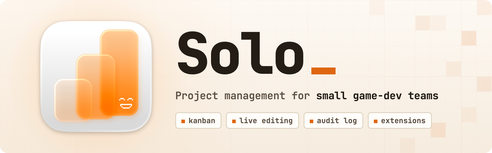
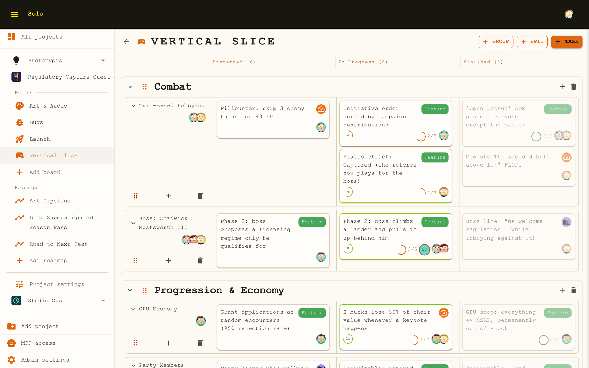
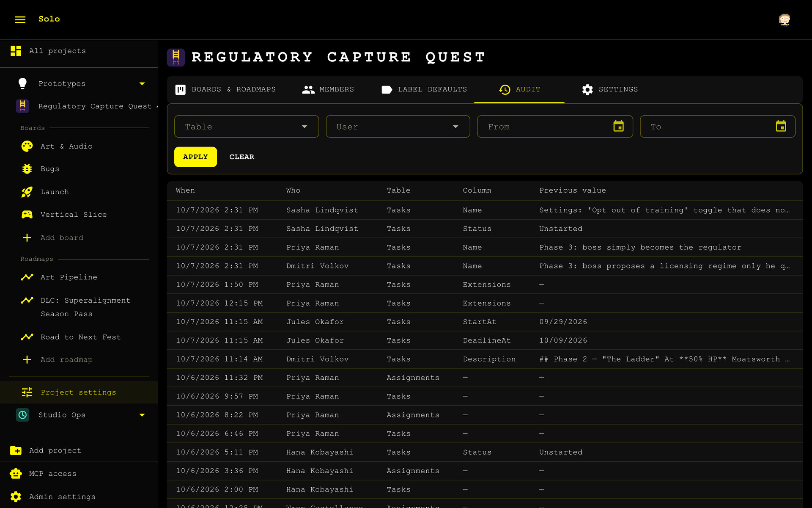
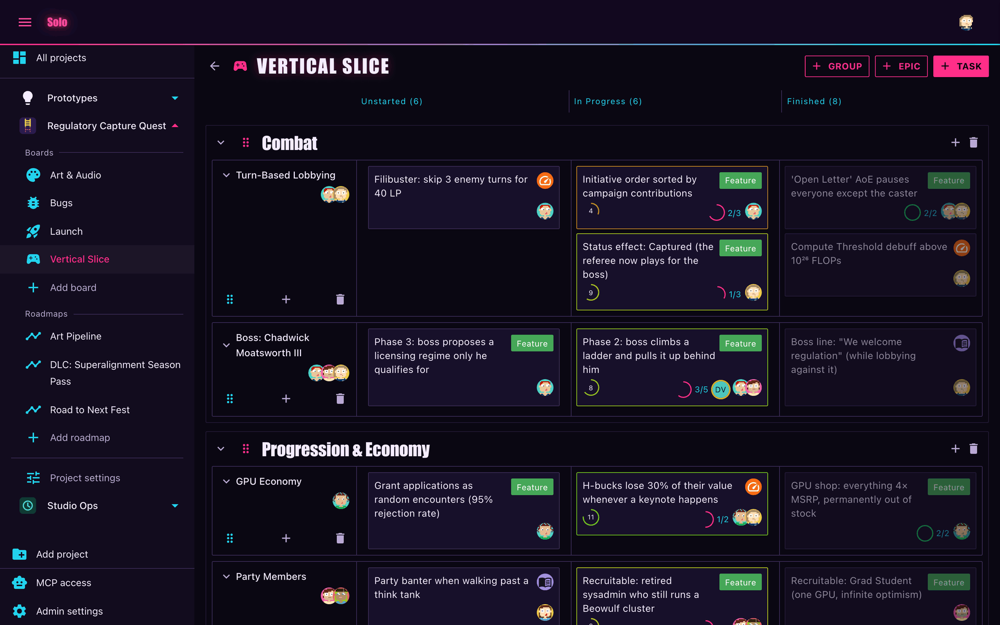
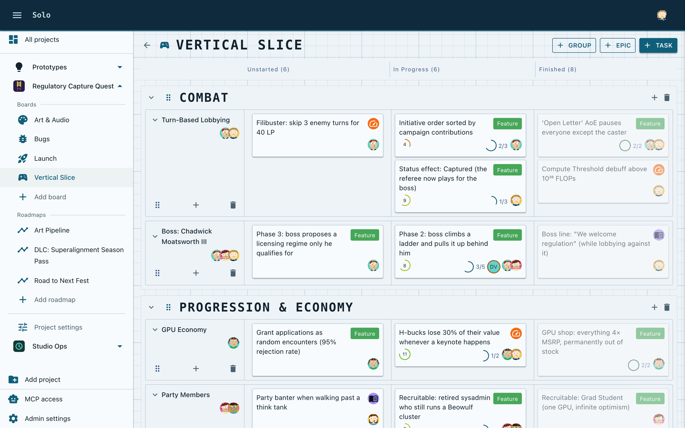
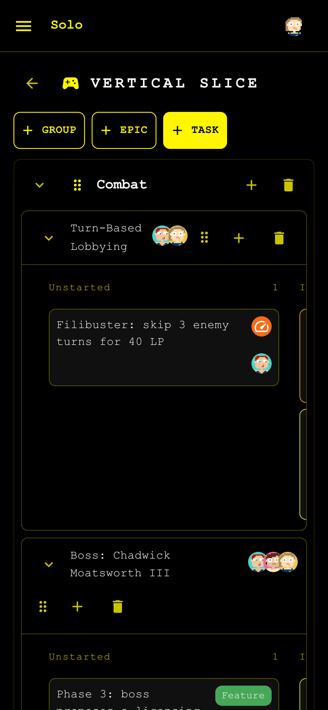
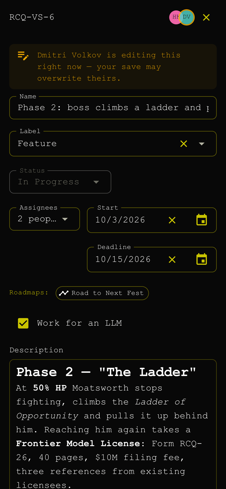
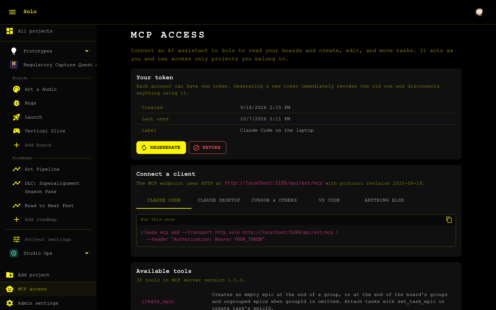
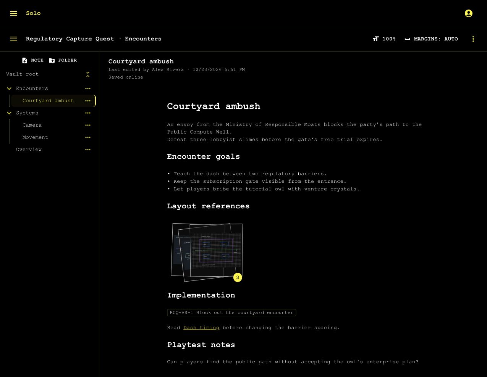

<picture>
  <source media="(prefers-color-scheme: dark)" srcset="docs/images/readme-header-dark.png">
  
</picture>

[](https://github.com/HunterAhlquist/Solo/actions/workflows/release-desktop.yml) [](https://github.com/HunterAhlquist/Solo/actions/workflows/ci.yml)

A simple project management tool for small teams: Kanban boards with epics/tasks/sub-tasks as swim-lanes, single-provider OIDC SSO, live editing over SignalR, full audit logging, themes, and extension support.

**Docs: [hunterahlquist.github.io/Solo](https://hunterahlquist.github.io/Solo/)** for using the app, running an instance, and writing extensions and themes.

<picture>
  <source media="(prefers-color-scheme: dark)" srcset="docs/images/screenshots/board-dark.png">
  
</picture>

First-party extensions are available in the release downloads:

- [MCP](#mcp-server-bundled-extension)
- [Roadmaps](#roadmaps-bundled-extension)
- [Design Docs](#design-docs-bundled-extension)

**Stack:** ASP.NET Core Web API · EF Core + PostgreSQL · SignalR · OIDC (Google, Microsoft Entra, or any compliant issuer). The Blazor WASM client is served by the same host; one container + Postgres is the whole deployment.

No issue reporting, or public pull requesting. I tailored this to my own needs and just wanted to share it with the world if someone else can get use out of it. 
If you REALLY need to tell me about a problem security related, you can report a security issue in the "Security and quality" page of this repo.
Otherwise you can fork it and make it infinitely better than I could ever.

<details>

<summary>AI Usage Disclaimer (Unhinged Alert)</summary>


This entire project is slopped up by my lazy ass because I hate Jira so much.

I freaking love PROOMPTING, I PROOMPT every day.
- 10 billion lines of code
- 10 billion proompts
- 10 billion security vulnerability
- 10 billion gallons of water GONE

AI is melting my programmer brain, please take away my Claude(TM) Pro(TM) subscription, I am begging you.

### Le epic claug face:


Nerd emoji lookin ahh

### Picture of Anthropic scanning books for their AI models:


</details>

## Support
I dogfood this app by project managing my game: [The Dreamer Must Die](https://store.steampowered.com/app/2116590/The_Dreamer_Must_Die/?beta=0)
I don't vibe-code it unlike this project.

If you want to support me, give me a wishlist and buy the game (when it's out.)

## Quick start

To run an instance you need a Docker host, an OIDC client id from your identity
provider, and an address people will reach the app at. Everything else is in the
compose file.

1. **Register an OIDC client.** In Google Cloud Console or Entra ID, create a
   client for a browser SPA (authorization code + PKCE) with your Solo address
   as the redirect URI. One provider per deployment, switching later is
   unsupported. Google: copy the **full** client id, the one ending in
   `.apps.googleusercontent.com`.
2. **Set up** the docker compose:

   The prebuilt image on GHCR is public, so the host pulls it without signing
   in to the registry. To run your own build instead, build the image from a
   checkout of this repository (`docker build -t solo .` at its root) and use
   `image: solo` in place of the `ghcr.io` one below.

   Here is an example that should get you started, though I recommend you use a secrets manager for the passwords.
   ```yaml
   services:
      solo:
         image: ghcr.io/hunterahlquist/solo:latest
         restart: unless-stopped
         depends_on:
            postgres:
               condition: service_healthy
         ports:
            - "30080:8080"
         environment:
            ConnectionStrings__Default: "Host=postgres;Port=5432;Database=solo;Username=solo;Password=CHANGE_ME_DB_PASSWORD"

            # Example for google auth, ClientId is that .apps.googleusercontent.com domain you were given.
            Auth__Authority: "https://accounts.google.com"
            Auth__ClientId: "CHANGE_ME_OIDC_CLIENT_ID"
            Auth__Provider: "google"

            # -- First-run setup account -------------------------------------------
            # Used only by the setup wizard; permanently disabled after the wizard
            # hands super admin off to your SSO account. Until that handoff these
            # credentials are the way in, and only a per-IP rate limit stands in
            # front of them. The password must be at least 20 characters and not
            # a CHANGE_ME placeholder, or the account stays disabled:
            #   openssl rand -base64 32
            Setup__Username: "admin"
            Setup__Password: "CHANGE_ME_SETUP_PASSWORD"

         volumes:
            - solo-themes:/data/themes
            - solo-extensions:/data/extensions

         healthcheck:
            test: ["CMD", "bash", "-c", "exec 3<>/dev/tcp/127.0.0.1/8080"]
            interval: 30s
            timeout: 5s
            retries: 3
            start_period: 30s

      postgres:
         image: postgres:17
         restart: unless-stopped
         environment:
            POSTGRES_DB: solo
            POSTGRES_USER: solo
            POSTGRES_PASSWORD: "CHANGE_ME_DB_PASSWORD"
         volumes:
            - solo-pgdata:/var/lib/postgresql/data
         healthcheck:
            test: ["CMD-SHELL", "pg_isready -U solo -d solo"]
            interval: 10s
            timeout: 5s
            retries: 5

   volumes:
      solo-pgdata:
      solo-themes:
      solo-extensions:
   ```
   Replace every `CHANGE_ME` value before the first start. The setup password
   is the one that matters most, since it is the way in until setup finishes:
   it has to be at least 20 characters and can't be a `CHANGE_ME` placeholder.
   Anything else leaves the setup account disabled, and the wizard and the
   startup log say why. `openssl rand -base64 32` makes a good one.
4. **Complete setup.** Browse to the app and sign in with the static
   `Setup__Username` / `Setup__Password` account. The wizard verifies SSO
   sign-in and sets audit retention; finish it while signed in with your own SSO
   account, which becomes the permanent super admin. The static account is
   disabled for good at that point.

From there, invite your team and hand out the URL. Optional extras: put it
behind a reverse proxy or the Cloudflare tunnel the compose file has commented
out, install the [desktop app](#desktop-app), add [themes](docs/themes.md), or
drop in [extensions](#extensions) such as the bundled MCP server.

>[!IMPORTANT]
>Everything after this is written by an LLM, sorry for the slop.

## Tour

The screenshots show a demo instance tracking *Regulatory Capture Quest*, a
turn-based RPG in which a scrappy open-weights lab fights its way to the capital
to stop OmniMind from passing the safety rules it wrote for everyone except
itself. The studio, its eight-person team and OmniMind's CEO, Chadwick
Moatsworth III, are all fictional.

### Tasks

Clicking a card opens the task in a drawer: a markdown description, labelled
sub-tasks, start and deadline dates, the comment thread, and the roadmaps the
task is on. Presence is live over SignalR. Here Hana has the task open while
Dmitri edits its description, so Priya gets a warning before saving over
Dmitri's work.
The **Work for an LLM** flag comes from the [MCP extension](#mcp-server-bundled-extension).


### Audit log

Every changed column is recorded with who changed it, when, and the value it
replaced, and each project's log can be filtered by table, person and date. It
is how you find out who renamed Phase 3 to "boss simply becomes the regulator",
and who renamed it back.



### Themes

Three themes ship in the image: Ahlquist Interactive (the default, above),
Arcade and Blueprint. The super admin picks one for the whole instance, and
each person picks light or dark for themselves. To add your own, see
[docs/themes.md](docs/themes.md).

<table>
  <tr>
    <td width="50%"></td>
    <td width="50%"></td>
  </tr>
</table>

### On a phone

The same client, at phone width.

<p>
  
  &nbsp;
  
</p>

## Extensions

Solo can be extended with packages that add API endpoints, database tables of
their own, hooks that intercept core write operations, and pages in the client.
How to write one: [docs/writing-extensions.md](docs/writing-extensions.md). To start one, `dotnet new install HunterAhlquist.Solo.Templates` adds a **Solo Extension** project template to `dotnet new`, Visual Studio and Rider. Design and rationale: [docs/extension-plan.md](docs/extension-plan.md).

An extension package is a `.zip` — `extension.json` at the root, plus `server/`,
`client/` and `content/` — dropped into the extensions directory
(`/data/extensions` in the deployment template).

A package's **client half** is a Razor class library the browser downloads at
bootstrap and hands to the router, so its `@page` routes resolve like any other.
Its pages resolve MudBlazor, dialogs and JS interop from the host, and call the
API through `ISoloClientApi` — the host's own authenticated client, so an
extension shares the app's credential rather than inventing one. Use its
`ResolveExternal` for any address a person copies out of the app: in the desktop
shell the page's own origin is a local proxy, and only the instance's address
works in another tool. A manifest nav
entry whose route contains `{projectAlias}` renders per project, gated on the
viewer's role in it; one without it is instance-level and sits in the sidebar
footer.

> **Installing an extension is deploying code.** A server extension runs
> in-process with the database connection string, and a client extension runs in
> the same browser context as the session token. There is no sandbox and the
> manifest's declarations are not a security boundary. Trust a package exactly as
> much as you trust the image.

**Unlike themes, there is no rescan.** Controllers, hooks and DI are fixed once
the host is built, so installing, updating or removing an extension takes a
container restart. A package that fails to load is reported in Admin settings
and skipped; the instance still starts.

Each extension that stores data owns a Postgres **schema** (`ext_<id>`) inside
the existing database — not a separate database, so nothing extra to back up.
Its migrations run at startup after core's, gated on the same
`Database__AutoMigrate`. A failed migration disables that one extension (its
endpoints answer `503` naming the reason) rather than taking down the instance.

On a **first install** the log carries a `fail:` line from EF —
`SELECT ... FROM ext_<id>."__EFMigrationsHistory"` — immediately before the
migration succeeds. That is EF probing for a history table that does not exist
yet, exactly as core does against `public` on a first boot; it is not a failure.
The lines that report the real outcome are Solo's own, on either side of it:
`Extension '<id>': applying migrations to schema ext_<id>.` then
`Extension '<id>' migrated into schema ext_<id>.` A restart shows neither the
probe nor any `fail:` line.

Removing a package keeps its data, and Admin settings then lists the extension
as installed-but-absent — which is what makes it possible to offer a purge later
rather than leaving an orphan schema nobody can attribute. Purging drops the
schema *and* strips the extension's keys from core's per-entity field bags; it
is super-admin only, requires retyping the extension id, and is refused while
the extension is still loaded.

### MCP server (bundled extension)

**`solo-mcp`** ([extensions/Mcp](extensions/Mcp)) lets an LLM client read and edit Solo's boards. It is a package like any
other, not part of the image: download `solo-mcp-<version>.zip` from the
[releases](../../releases), copy it into the extensions directory, and restart.
`build/pack-mcp-extension.sh` builds the same archive locally.

The package carries both halves: the server ([Solo.Mcp](extensions/Mcp/Solo.Mcp)) and
the pages ([Solo.Mcp.Client](extensions/Mcp/Solo.Mcp.Client)), whose **MCP access**
entry appears in the sidebar once the extension is installed. Each person
generates their own token there and pastes the connection snippet the page
produces into Claude Code, Claude Desktop, Cursor, VS Code or any other MCP
client. Claude Desktop gets a different snippet from the rest: its config file
launches local processes only and drops an entry carrying a URL, so the page
hands it an `mcp-remote` bridge instead of the HTTP shape. The endpoint is `POST /api/ext/mcp` — streamable HTTP, stateless, no
event stream — authenticated by `Authorization: Bearer solomcp_…`.



A token **acts as the person who generated it**: every tool call re-enters
Solo's own REST API carrying that token, so it gets the same authorization,
auditing and live-board broadcasts as the same action performed in a browser,
and it reaches only the projects its owner is a member of. Tools address a task
by GUID or by full serial number (`DMD-PXW26-2`), so an agent holding a serial
needs no id discovery.

Tokens live in the extension's own `ext_mcp` schema and are stored only as
SHA-256 hashes, so nobody — super admin included — can read one back. One live
token per account: generating a new one blocks the old one immediately, and the
revoked row stays in the audit. A super admin
sees a second section on the same page: every token's owner, creation and
revocation times and a 24-hour usage graph, a per-row **Revoke** for cutting off
one person, and an emergency **Revoke all** for cutting off the instance.

### Roadmaps (bundled extension)

**`solo-roadmap`** ([extensions/Roadmap](extensions/Roadmap)) adds timelines. A roadmap gathers tasks from any of a project's boards into one
row each, drawn as a bar from start date to deadline over a day grid with
sprint stripes. Dragging a bar reschedules the task itself, so the board and
the roadmap never disagree about a date. Milestones mark dates that belong to
the roadmap rather than to a task. Missed deadlines flash red and are listed
under the grid, which is how the eleven-minute battle theme got caught.
Whoever else has the roadmap open shows in the header.

Install it like the MCP package: `solo-roadmap-<version>.zip` from the
[releases](../../releases), or `build/pack-roadmap-extension.sh` locally. The
full feature list is in [its README](extensions/Roadmap/Solo.Roadmap/README.md).


### Design Docs (bundled extension)

**`solo-design-docs`** ([source](extensions/DesignDocs)) adds project vaults with
folders, collaborative Markdown, task links, images, and sketches.
People can write together and see each other's profile cursors.
Images and sketches form stacks that open in an attachment viewer.
The fullscreen sketch editor supports Pencil input, selection tools, and PNG export.

Import an Obsidian ZIP when creating a vault, or export an existing vault as
Markdown and images. The server stores notes and attachments in PostgreSQL.
Download a vault to read and edit offline. Changes save on the device and
synchronize while Solo is open.
Install `solo-design-docs-<version>.zip` from a compatible release and restart Solo.
See the [user guide](site/guide/design-docs.md) and [build instructions](extensions/DesignDocs/README.md).



## Desktop app

[src/Solo.Desktop](src/Solo.Desktop) is an Electron shell around the unmodified Solo web client. The shell serves the published Blazor WASM build from a local origin (`http://localhost:41321`) and reverse-proxies `/api/*` and `/hubs/*` (REST, images, SignalR WebSockets) to a Solo instance added in **Settings** — so the client runs byte-for-byte identical to the hosted build, same-origin, with no CORS anywhere and no changes to the API. It can hold several instances, each in a window of its own on a local port of its own; see [its README](src/Solo.Desktop/README.md#instances).

### Desktop Sign-in

Google refuses to run its sign-in pages inside Electron ("this browser or app may not be secure"), so the shell signs in outside the app on the **instance's own origin** — on macOS in a **sign-in window** over the app, elsewhere in the **default browser** — then returns through a PKCE-bound loopback callback:

1. The in-app **Authorize in browser** button opens an ephemeral `127.0.0.1` listener, generates a PKCE verifier, and asks the instance to open a flow (`POST api/auth/desktop/start`) with that port and the verifier's challenge.
2. The shell opens `https://<instance>/desktop-auth?state=…`. On macOS that is Apple's web authentication window (`ASWebAuthenticationSession`, through a small native add-on in `src/Solo.Desktop/native/auth-session`): it is Safari, or a default browser that supports it, so an existing Google sign-in carries over. Elsewhere — or if the add-on isn't built — it is the default browser. The page wears the instance's theme, signs in with Google, and sends a short-lived, one-time authorization code to the loopback listener. On macOS the listener then redirects to `com.solo.desktop://…`, which closes the sign-in window.
3. The shell redeems that code with its verifier (`POST api/auth/desktop/redeem`) and receives a **long-lived Solo session token** (sliding expiry, default 30 days via `Auth__SessionDays`), exactly once. A remote client that started the flow never receives the loopback code, and an intercepted code is useless without the verifier.

The page reaches Google one of two ways:

- **By default, Google's button.** Its sign-in opens in a popup — a second window — after a click, on the origin the operator already registered for the web client, so **no extra provider registration is needed**.
- **Redirect mode** (`Auth__DesktopRedirect=true`). The page goes straight to Google's OpenID Connect sign-in in the same window, with no click; Google posts the ID token back to `/desktop-auth`. Register `https://<instance>/desktop-auth` as an authorized redirect URI first — see [Desktop sign-in with Google](site/admin/configuration.md#desktop-sign-in-with-google). Only the desktop sign-in changes; the web sign-in keeps Google's button.

Either way the ID token's `nonce` must be the flow's state, so a token from any other sign-in cannot complete this one.

Signing out revokes the session server-side. Both the desktop app and instance must support the secure loopback flow; incompatible versions fail closed, and the current desktop app identifies an old server response and asks for an update. (The client detects the shell via `window.soloDesktop`, exposed by the preload, and swaps the GIS widget for the plain button — Google's widget never loads inside the app.)

For **other OIDC providers** (code + PKCE redirect) the flow runs in-app: add `http://localhost:41321/authentication/login-callback` as a redirect URI. These providers redirect the whole window rather than a popup; whether that works depends on the provider's webview policy.

## Development

Requires the .NET 10 SDK. Docker is needed for the integration tests (Testcontainers Postgres) — without it they are skipped.

```sh
dotnet build Solo.slnx
dotnet test Solo.slnx
```

Solution layout:

```
src/Solo.Api           ASP.NET Core host: controllers, SignalR hub, auth, serves the WASM client
src/Solo.Data          EF Core DbContext, entities, migrations, audit interceptor
src/Solo.Shared        DTOs, enums, hub contracts (shared with the WASM client)
src/Solo.Extensibility the public contract extensions compile against (see Extensions)
src/Solo.Extensions    the extension host: package loading, hook dispatch, registry
tests/                 unit (Solo.Data.Tests) + integration (Solo.Api.Tests) + bUnit (Solo.Client.Tests)
extensions/            the bundled extensions, each its own solution (not in Solo.slnx)
templates/             the `dotnet new` template for a new extension (not in Solo.slnx)
```

`Solo.slnx` is core only. The bundled extensions build the way a third-party
one does, from the contract's NuGet packages — but from the ones
`build/pack-contract.sh` packs out of `src/` into `artifacts/nuget`, never the
copies published on nuget.org, so they always build against this checkout's
contract:

```sh
build/pack-contract.sh
dotnet test extensions/Mcp/Solo.Mcp.slnx
dotnet test extensions/Roadmap/Solo.Roadmap.slnx
```

Migrations are applied automatically on startup. To add one:

```sh
dotnet tool restore
dotnet ef migrations add <Name> --project src/Solo.Data --startup-project src/Solo.Data
```

### Running

```sh
cd src/Solo.Desktop
npm install
npm run build:client   # dotnet publish Solo.Client → ./wwwroot
npm start
```

On first launch a settings window asks for an instance address (e.g. `https://solo.example.com`). **Add** performs an anonymous fetch of `/api/config/auth` to confirm the address is a Solo instance, signs you in to it in the browser, and then opens it. Add more, or remove one, via *Solo → Settings…* (`Cmd/Ctrl+,`), and open them from *Solo → Open Instance*. Settings live in `settings.json` under Electron's `userData` directory; each instance's local port (counting up from `41321`) can be changed there if it clashes.

During development, `SOLO_CLIENT_DIR=/path/to/publish/wwwroot npm start` serves client assets from anywhere without re-copying.

## CI & image publishing

[.github/workflows/ci.yml](.github/workflows/ci.yml) builds and tests every PR into `main`. Pushing a **`v<version>`** tag releases the whole train: this workflow publishes the container image and the extension packages, [release-desktop.yml](.github/workflows/release-desktop.yml) publishes the installers, and both attach to **one** GitHub release for that tag, using the workflow's `GITHUB_TOKEN` — no extra secrets needed. One release per train means marking it latest is unambiguous. A changed container image goes to **`ghcr.io/hunterahlquist/solo`**; the tag is stripped to produce the image tags, so `v1.18.0` publishes `1.18.0`, `1.18`, `latest`, and `sha-…`, while a prerelease like `v1.18.0-rc.1` skips the floating `1.18`.

Each component is diffed separately against the previous `v*` tag the commit descends from, over the inputs that can actually change it, and only what changed is built and attached — a test-, documentation- or workflow-only commit releases nothing but notes, and an unchanged extension doesn't get a second identical zip. Because a release therefore holds only part of the product, every release also carries a `release-manifest.json` describing *all* of it, with each unchanged component still pointing at the release that holds its asset. That file is the update feed for the server's update indicator, in-place extension updates, and third-party extension packages. **[docs/releases.md](docs/releases.md) is the full account**, including the desktop updater feed and the two constraints that are easy to break by accident; **[docs/updates.md](docs/updates.md)** covers the other half — how an instance, a desktop app and an installed extension find out they are behind, and what applying an update actually does.

The extension SDK is a series of its own. Pushing an **`sdk-v<version>`** tag runs [release-sdk.yml](.github/workflows/release-sdk.yml), which publishes `HunterAhlquist.Solo.Shared` and `HunterAhlquist.Solo.Extensibility` to nuget.org. The tag has to name the contract version in `build/contract-package.props` (`sdk-v1.9.0` for `1.9.0`), and the workflow refuses to publish while the repository is private, because nuget.org never deletes a version and each package page links back here. It stores no API key: nuget.org issues a one-hour key through a [trusted-publishing](https://learn.microsoft.com/nuget/nuget-org/trusted-publishing) policy that names this repository, `release-sdk.yml` and the `nuget` environment, and the `NUGET_USER` repository variable holds the nuget.org profile name. A manual `workflow_dispatch` run is a rehearsal — it packs and uploads the packages as a workflow artifact and publishes nothing.

The same workflow publishes `HunterAhlquist.Solo.Templates`, the `dotnet new` template that scaffolds an extension, on a **`templates-v<version>`** tag. That version is the one in `templates/Solo.Templates.csproj`: its major and minor follow the contract the generated projects pin, and its patch is the template's own, so a template fix doesn't wait for a contract release. The workflow refuses to publish templates for a contract version nuget.org doesn't have yet.

### Packaging

```sh
npm run dist   # electron-builder → dist/ (arm64 dmg, nsis, AppImage)
```

CI does this automatically: pushing a **`v<version>`** tag runs [release-desktop.yml](.github/workflows/release-desktop.yml), which stamps `package.json` with the version from the tag, packages an Apple silicon macOS `.dmg` plus a `.zip` and Windows and Linux installers, and attaches them to that tag's GitHub release alongside the server and extension artifacts. The `.zip` is there because macOS installs an update from one — Squirrel.Mac cannot use a disk image. Builds are unsigned unless the Apple signing/notarization secrets are configured; a manual `workflow_dispatch` run uploads the installers as workflow artifacts without creating a release.

A tag whose commit changes nothing the installers are built from (`src/Solo.Desktop`, `src/Solo.{Client,Shared}`, `Icons/`, this workflow) is skipped rather than repackaged, measured against the previous `v*` tag it descends from — so an API- or docs-only release costs nothing here. The release still carries the previous `latest*.yml` feed forward, because electron-updater reads only the newest release and a missing channel file there is a broken update check rather than "no update".
